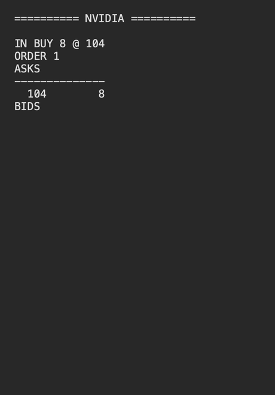

# MatchingEngine0

A single-threaded limit order book and matching engine in C++20, with price-time priority, partial fills, cancellation, and trade reporting. A TCP server accepts orders over a binary protocol and shows the book live.

Replacing per-price vectors with intrusive FIFO queues made the engine **136× faster** on a mixed workload with 100,000 orders at one price (0.17M → 22.8M operations/s). With many price levels the change makes little difference; [Performance](#performance) shows both cases.

## Features

- Buy and sell limit orders, with validation of quantity, price, and side
- Price priority across levels, FIFO priority within a level
- Exact and partial fills, including orders that sweep multiple makers or price levels
- Trades execute at the resting (maker) order's price; any unfilled remainder rests on the book
- Cancellation by order ID, with empty price levels removed
- Best bid, best ask, and order lookup

One `OrderBook` instance is one instrument.

## Build and run

Requires CMake 3.20+ and a C++20 compiler (GCC or Clang). GoogleTest is fetched automatically.

```sh
cmake -S . -B build -DCMAKE_BUILD_TYPE=Release
cmake --build build --parallel
ctest --test-dir build --output-on-failure
```

| Target | What it is |
| --- | --- |
| `orderbook` | The engine, as a static library |
| `protocol` | Binary encode/decode for order messages, as a static library |
| `server` | TCP server that matches incoming orders and redraws the book |
| `client` | Sends a stream of random orders to the server |
| `matching_engine` | Small scripted demo that prints a book |
| `orderbook_tests` | GoogleTest unit tests for the engine and the protocol |
| `latency_benchmark` | Per-operation latency at several queue depths, then the before/after numbers in [Performance](#performance) |

Pass `-DBUILD_TESTING=OFF` to skip the tests.

## Networked demo

The server owns one order book. The client connects over TCP and sends 100 random limit orders, one every 200 ms. After each order the server clears the screen and prints the order, any trades it caused, and the current book.

Run each in its own terminal:

```sh
./build/server
./build/client
```



The client picks the side 50/50, draws the price from a normal distribution around 100 (standard deviation 3, rounded to a whole number), and picks a quantity from 1 to 10. Buys and sells overlap around 100, so some orders rest and some trade.

### Wire format

Each order is a fixed 22-byte `NewOrder` message:

| Field | Type | Bytes |
| --- | --- | --- |
| Message type (`1` = NewOrder) | u8 | 1 |
| Client order ID | u64 | 8 |
| Side | u8 | 1 |
| Price | 32-bit integer | 4 |
| Quantity | 64-bit integer | 8 |

Integers are big-endian. Each field is written and read one byte at a time with shifts, never by copying a struct's memory, so the format doesn't depend on the compiler's padding or the machine's byte order. Decoding rejects a message of the wrong size or type; the engine rejects an invalid side, price, or quantity.

### Reading the byte stream

TCP delivers a stream of bytes, not messages: one `recv` can return part of an order, or several orders at once. The server appends what it receives to a buffer, decodes every complete 22-byte message in it, and keeps any leftover bytes for the next `recv`.

## Usage

```cpp
#include "OrderBook.h"
#include <iostream>

int main() {
    OrderBook book;

    auto ask = book.addOrder(60, 10'200, Side::Sell);   // rests on the book
    auto buy = book.addOrder(40, 10'300, Side::Buy);    // crosses the ask

    for (const Trade& t : buy->trades) {
        std::cout << t.executionQuantity << " @ " << t.executionPrice << '\n';  // 40 @ 10200
    }

    std::cout << book.findOrder(ask->orderId)->quantity << '\n';  // 20 left
    book.cancelOrder(ask->orderId);
}
```

```cpp
std::optional<SubmissionResult> addOrder(Quantity quantity, Price price, Side side);
bool cancelOrder(OrderId id);
std::optional<Price> bestBid() const;
std::optional<Price> bestAsk() const;
std::optional<Order> findOrder(OrderId id) const;
```

- `addOrder` returns `std::nullopt` for a nonpositive price or quantity or an invalid side. Rejected orders don't use up an ID.
- On success it returns the assigned order ID and the list of trades.
- `findOrder` returns a copy, and only finds orders still resting on the book.
- Prices are integers in whatever unit the caller chooses (for example, cents), so matching never compares floating-point values.

## Design

```cpp
std::unordered_map<OrderId, RestingOrder> m_idToOrder;  // owns every resting order
std::map<Price, PriceLevel> m_bids;                     // highest key = best bid
std::map<Price, PriceLevel> m_asks;                     // lowest key = best ask

struct RestingOrder { Order order; RestingOrder* prev; RestingOrder* next; };
struct PriceLevel   { RestingOrder* head; RestingOrder* tail; Quantity totalQuantity; };
```

Each price level is a doubly linked FIFO queue threaded through orders stored in the hash map. The hash map never moves its elements, so the links stay valid when it rehashes. To cancel, the engine finds the order by ID and unlinks it in O(1). It never has to search a queue.

The first version stored `std::map<Price, std::vector<OrderId>>`. Cancelling meant searching the vector, and filling the front order shifted every order behind it, so both grew linearly with queue depth.

N = orders at one price, P = number of price levels:

| Operation | Vector version | Current version |
| --- | --- | --- |
| Find order by ID | O(1) expected | O(1) expected |
| Find price level | O(log P) | O(log P) |
| Cancel an order within its level | O(N) | O(1) |
| Fill the front order | O(N) | O(1) |
| Add to a level | Amortized O(1) | O(1) |

Price levels are still a `std::map` (a balanced tree), so books with many levels still pay O(log P). Reordering the fields of `Order` also shrank it from 32 to 24 bytes by removing padding.

## Performance

The throughput section of `latency_benchmark` (`benchmarks/OrderBookBenchmark.cpp`) times 2,000,000 operations per workload after a 100,000-operation warmup and reports the mean. It calls the engine directly in one process: there is no I/O or networking. It uses only the public API, so it builds unchanged against the old version (`2f9ac08`).

The figures below compare the vector version (`2f9ac08`) with the current one (`2ee2fa6`). Each is the median of three runs on an Apple M5 using Apple Clang 21 with `-O3 -DNDEBUG`.

**Deep queues (about 100,000 orders at one price)**, where the redesign helps:

| Workload | Before (M ops/s) | After (M ops/s) | Speedup |
| --- | --- | --- | --- |
| Mixed: 50% add / 45% cancel / 5% match | 0.167 | 22.8 | 136× |
| Add, then cancel newest | 0.172 | 78.7 | 458× |
| Match one order, then replenish | 0.172 | 43.2 | 251× |
| Cancel a random order, then replenish | 0.156 | 24.0 | 154× |

Timed one at a time, p99 for a random cancel at this depth fell from 14,541 ns to 125 ns.

**Many price levels**, where it doesn't:

| Workload | Before | After | Change |
| --- | --- | --- | --- |
| Sweep 1,000 makers at one price | 50.9 μs | 11.5 μs | 4.4× faster |
| Sweep 1,000 makers across 1,000 prices | 50.8 μs | 47.8 μs | 1.06× faster |
| Add/cancel across 10,000 price levels | 63.5 ns | 71.5 ns | 13% slower |
| Add/cancel across 100,000 price levels | 115.8 ns | 117.8 ns | 2% slower |

The remaining cost is the price-level tree, which a direct-index price ladder would address.

How to read these numbers:

- Throughput rows are means over many operations. The sweep rows and the p99 time single operations.
- The Mac timer ticks every ~42 ns, so single-operation latencies are rounded to multiples of that.
- Results come from a laptop without CPU pinning. They describe these builds and workloads, not production performance.

### Reproducing

Current engine (use a Release build):

```sh
cmake -S . -B build -DCMAKE_BUILD_TYPE=Release
cmake --build build --parallel
./build/latency_benchmark
```

The current engine finishes in a few seconds; the old version takes about a minute. Absolute numbers depend on the machine, so compare the two versions on the same one.

## Testing

- **Unit tests:** 33 GoogleTest cases for the engine, covering validation, ID assignment, cancellation, crossing rules, partial and exact fills, maker-price execution, multi-level price priority, and FIFO on both sides. They cover 95% of lines in `OrderBook.cpp`. Another 7 cases check that `NewOrder` messages survive an encode/decode round trip and that malformed messages are rejected.
- **Sanitizers:** both versions pass the full test suite under AddressSanitizer and UndefinedBehaviorSanitizer.
- **CI:** GitHub Actions builds and runs all tests on every push and pull request to `main`.

## Limitations

- Limit orders only: no market, IOC/FOK, modify, account ownership, or self-trade prevention.
- Single-threaded, with no persistence.
- The server handles one client at a time, and only prints results: clients get no acknowledgement or fill messages back.
- The server's stream-splitting logic is checked by hand, not by unit tests.
- Summing many valid quantities can overflow `Quantity`.
- An allocation failure mid-submission can leave the book inconsistent.
- Order-ID exhaustion isn't handled.

`OrderBook` can't be copied or moved: its price levels hold pointers into its own hash map, so a copy would point into the original.

## Roadmap

1. Multiple clients that receive acks and fills, and can cancel.
2. A UDP market-data feed and a simple market-maker bot.
3. End-to-end latency and throughput numbers under load.
